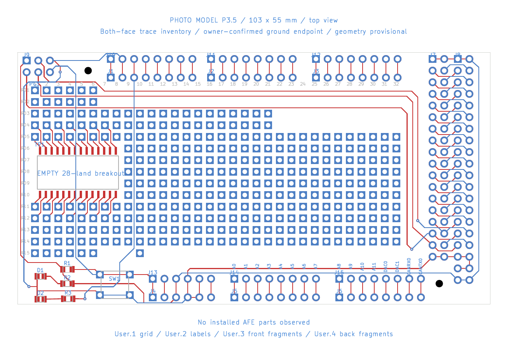
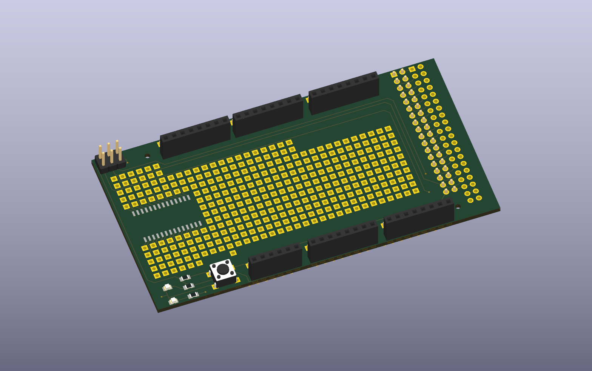

# Your Mega PrototypeShield V3 carrier

Open [mega-proto-carrier.kicad_pro](mega-proto-carrier.kicad_pro) in **KiCad 10.x**.
Revision **P3.5** incorporates the seven stripped-board photographs
[IMG_2135](photo/IMG_2135.jpeg) through [IMG_2141](photo/IMG_2141.jpeg).
The PCB records the carrier; the schematic records its contacts and photo-traced nets.
The [P3.1 correction record](routing-corrections.json) links the reviewed R1/R2 and bottom digital-header routes to close-up photo crops.



## Resistor values from the photo

The [IMG_2131 close-up](evidence/resistor-markings-IMG_2131.jpg) clearly shows all three markings, top to bottom:

| Carrier reference | Marking | Nominal value | Traced role |
|---|---|---|---|
| R1 | 103 | 10 kΩ | RESET pull-up |
| R2 | 102 | 1 kΩ | PWR LED series resistor |
| R3 | 102 | 1 kΩ | STAT LED series resistor |

These values are already recorded in the PCB and schematic. They are nominal values decoded from the markings, not resistance measurements. [Structured evidence](resistor-values.json).

## Corrections from the exposed pads

- The parallel main/breakout header rows are approximately **4.064 mm apart**, rather than 2.54 mm. Along each row the pitch remains 2.54 mm. Main header positions, grid registration, switch/LED/resistor placements, SPI transitions and small-hole positions were revised against the newly visible pads.
- J7/J8's first 5 V row remains level with J12. **J3 lies between the D22/D23 and D24/D25 rows.** This corrects P2.1's mistaken assertion that J3 aligned with D22/D23. The bottom 5 V row is near J15; the remaining estimated offset is 0.284 mm.
- SW1's **upper pair is RESET**, joined by front copper. Its **lower pair is GND**, joined by back copper and routed to power-header ground. P2.1's lower-right-pad-to-RESET connection was wrong and has been removed.
- The 103 resistor joins RESET on its right. **IMG_2136 reveals a front diagonal joining R1 left to R2 right / +5 V**, also establishing +5 V at corner pad J9.1.
- The middle 102 resistor's right land reaches **+5 V / J4.3**. Its left land feeds the PWR LED. The two LED left lands share ground through the lower switch pads; LED polarity is still unmeasured.
- The bottom outer digital 5 V pair is **J8.39/J8.40** in this model. Its crossbar is on **B.Cu**, not F.Cu (IMG_2138/2141). The back lower-edge +5 V feed from J13.3 is now included.
- The J13.4 → J7.35 front ground perimeter is moved 1 mm toward the prototyping field, with a vertical departure and chamfer at J13.4. Minimum modeled clearance to other header pad copper is now **1.286 mm**, previously 0.286 mm. See [ground-route-clearance.json](ground-route-clearance.json); these values use provisional CAD pad sizes, not physical measurements.
- J7.31 / D50 now has a horizontal final entry into the pad’s middle-right in the flipped B.Cu view, per your correction. In canonical top view the same segment enters from the left; its D50 net is unchanged.
- IMG_2139 confirms that the D13/STAT back trace departs **inner J1.3**, not outer J10.3. The incorrect back segment between those rows has been removed; their existing front spoke remains. The rest of the D13 dogleg reaches the STAT resistor.
- Former fragments UF-01, UB-02 and UB-03 are now assigned copper. You confirmed UB-01's destination as **J10.2 / GND**. CORNER-HEADER-B now joins J9.5 to J10.2; the final bends under the plastic remain estimated.

The corner pad names below describe **model coordinates in top view**, not a standard ICSP pin-number convention:

| J9 pad | Position | Photo-traced destination |
|---|---|---|
| 1 | upper left | +5 V via R1 left → R2 right copper link |
| 2 | lower left | D50, via lower long front trace / V50 |
| 3 | upper middle | D51, via upper long front trace / V51 |
| 4 | lower middle | D52, via middle long front trace |
| 5 | upper right | GND through corner transition / left-edge back route |
| 6 | lower right | RESET / SW1 upper-left pad |

The default model represents the **normal populated carrier**: SW1, J9 and the main headers are fitted, with SW1/J9's DNP flags cleared. One specimen was stripped solely for backlit routing photography; the other boards retain their switch and header. On that photo specimen, J1-J6's front sockets and SW1/J9 were removed, reverse male pins remain, and J7 is partly stripped. These removals expose the copper; they are not intended assembly omissions. No installed AFE circuit or added hand wiring is visible.

## Review what remains uncertain

Enable **User.5** in **Appearance → Layers**. The **Carrier review questions R2** group contains Q01-Q12, 33 lettered points, enlarged corner/control drawings, and question cards. Entries marked **PHOTO RESOLVED** still await electrical measurements.

[Review picture](preview/review.png) · [Questions](REVIEW-CHECKS.md) · [Measurement sheet](review-checks.csv)

Q02 records your confirmed J9.5 → J10.2 / GND endpoint; Q05 records the photo-resolved R1/R2 supply link. Neither includes a supplied resistance reading. Remaining checks include:

- **Q09:** you confirmed a physical crack near J9 on the photo specimen on 2026-10-30. The other boards have not been assessed for that damage. Circles mark that specimen's nearby SPI/reset routes to check. Copper continuity across the crack remains unmeasured; see [owner-observations.json](owner-observations.json).
- **Q10-Q12:** LED polarity, via features, continuity and mechanical dimensions.

The original P2.1 review and continuity worksheets are archived under `evidence/`; no meter readings have been supplied. Use [continuity.csv](continuity.csv) for the updated route checks with the board removed and unpowered.

## 3D assembly view

Reopen the PCB from disk, then choose **View → 3D Viewer** (**Option+3** on macOS). The normal populated carrier now has **20 component bodies**: six front female sockets, reverse male pin strips (including J7), the corner header, reset switch, two LEDs and three resistors.



[Underside 3D preview](preview/3d-bottom.png). If a viewer filter is active, enable both SMD and through-hole components in the 3D Appearance panel.

The empty grid, empty SMD breakout and outer digital breakout remain bare. Body heights, pin lengths and the generic straight corner header are visual approximations; LED model markings do not establish polarity. Copper, pad locations, net assignments and saved project preferences are unchanged.

Nine unmodified KiCad STEP assets are included under `models/kicad/`, referenced with `${KIPRJMOD}` so another computer does not need these models at an absolute installation path. [Provenance and licensing](models/kicad/README.md) · [Model assignments and verification](models-3d-evidence.json).

`models_3d.py` can restore these per-instance assignments without rebuilding copper. `build_model.py` also applies them during a deliberate baseline rebuild and now preserves an existing `.kicad_pro` file's settings.

## Coordinates and evidence

The owner measured the outline as **103 × 55 mm**. All other dimensions remain photo estimates. Header-row separation is rounded to 4.064 mm; lower main-row y is rounded to 53.5 mm from the overview and control photographs. The fit is not a substitute for a physical measurement.

`PG1.R01C01` is the upper-left prototyping hole, at estimated board-local (3.8, 8.3) mm. Rows increase downward and columns to the right. There are **341 holes** in an irregular 32-column / 15-row pattern at nominal 2.54 mm pitch.

`TP1.T01`–`T14` and `B01`–`B14` identify the empty SMD land rows, left to right. They are coordinate IDs, not an IC pinout. The 28 alternating fanout connections remain modeled; those holes are already connected to SMD lands.

| Lands | Connected grid holes |
|---|---|
| T01, T03, …, T13 | R05C01–R05C07 |
| T02, T04, …, T14 | R04C01–R04C07 |
| B01, B03, …, B13 | R11C01–R11C07 |
| B02, B04, …, B14 | R12C01–R12C07 |

- `F.Cu` / `B.Cu`: interpreted front/back copper, always in top-view coordinates.
- `User.1`: grid IDs; `User.2`: Due names and model labels. These are CAD annotations, not recovered physical silkscreen.
- `User.3` / `User.4`: front/back open-end markers. P3.3 has no remaining open route endpoints or unclassified fragments.
- `User.5`: review overlay; hide it for an ordinary board view.
- [pad-map.csv](pad-map.csv): every pad's board-local coordinates. The native CAD page adds (80, 80) mm.
- [photo-registration.json](photo-registration.json): manually picked image landmarks and projective fits. Close-up grid fit residual describes the picked landmarks only, not absolute mechanical accuracy.
- [model-evidence.json](model-evidence.json): all eleven photo paths/hashes and assembly state.
- [wiring-evidence.json](wiring-evidence.json) / [trace audit](TRACE-AUDIT.md): 28 SMD fanouts, **115 supplemental route sections**, five transition features, approximate bends and provenance.

Physical Mega labels A12-A15 are named DAC0/DAC1/CANRX0/CANTX0 for the Due. Shared Due net names describe the intended interface; a shared name alone does not prove an on-carrier copper connection. No IOREF or additional Due SDA1/SCL1 positions are modeled.

## Keep the carrier separate from the circuit

This project models the board you own. [afe-shield](../afe-shield/README.md) remains the intended AFE design, and [reference/arduino-due](../reference/arduino-due/README.md) contains the Due reference files. These projects were not overwritten by this reconstruction.

Use the [AFE build guide](../../docs/afe-prototype.md) as the circuit specification. Place planned components by grid addresses, verify existing substrate connections first, and keep planned assembly separate from the photographed carrier. Pad, drill, trace width and via dimensions are provisional; the model is not manufacturing data.

## Files and checks

The project-local `Carrier.pretty/` and `Carrier.kicad_sym` libraries accompany the three native KiCad files. `build_model.py` regenerates the baseline and **overwrites CAD edits**. Once you edit in KiCad, rebuilding must be deliberate. Footprints are locked against accidental movement.

`check_model.py` checks native reload, outline, all pad IDs, SMD fanout endpoints, every recorded route, corrected net assignments, DNP state, header relationships, review circles and schematic/PCB net parity. Its result is [validation.json](validation.json). Native DRC is recorded separately in [drc-review.json](drc-review.json).

KiCad 10.0.6 checks: **244 schematic contacts match the PCB; ERC has zero errors and zero warnings.** All pad centres are inside the outline. The board has **344 track segments and five vias**. DRC has **no shorts, crossing tracks or ordinary clearance violations**. Remaining findings are eleven copper-to-edge clearances. There are no dangling tracks or unrouted connections. Dimensions, hidden copper and physical continuity remain unverified; this is not a clean fabrication DRC.

Run the internal check using KiCad's bundled Python:

```sh
/Applications/KiCad/KiCad.app/Contents/Frameworks/Python.framework/Versions/3.9/bin/python3 hardware/mega-proto-carrier/check_model.py
```
