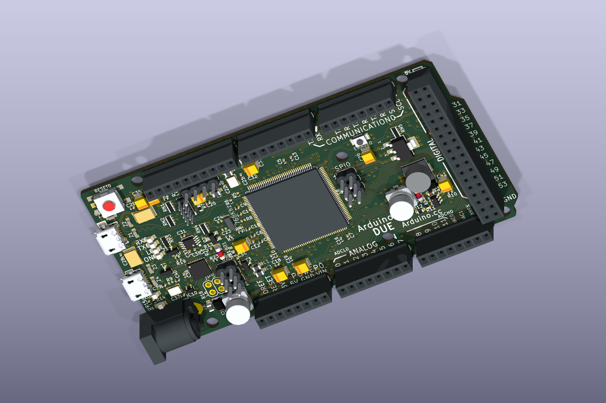

# Due mechanical models and V03 assignments

The owner supplied `arduino-due-1.snapshot.12.zip` on 2026-11-01.
It is preserved, unmodified, under `source/`. Unlike the two duplicate
EAGLE downloads removed from the parent directory, this archive contains
real 3D geometry: a complete STEP assembly, IGES, SolidWorks parts and an
assembly, and a rendered picture. [Archive inventory and hashes](sources.json).

The unmodified STEP and supplied picture are extracted under `assembly/`.
The [working V03 KiCad PCB](../v03/Arduino-DUE-V03.kicad_pcb) now has
**119 individual model assignments**: 18 selected assembly bodies, 91
standard KiCad package bodies and 10 simplified special-part bodies.
All source components intended to be mounted have a visualization body;
four bare fiducials and six source items marked NM remain without models.
[Full population and exclusions](population.json).

For the 18 original assembly bodies, the source's
board size, 101.6 x 53.34 mm, and six mounting-hole centers match V03's
EAGLE source (largest center discrepancy below 0.000006 mm). Geometry,
source products, per-footprint transforms and derived-file hashes are in
[alignment.json](alignment.json).

The assembly's drawing plane is X/Z and its PCB top is at Y=+0.8 mm.
The conversion maps `(X, Y, Z)` to `(X, -Z, Y - 0.8)`, then removes the
native footprint's translation and rotation. Component models therefore
use unit scale and zero additional offset/rotation in KiCad. Each body
moves with its own footprint rather than with a single board-sized model.
Small offsets in the supplied assembly are retained, not silently snapped:
the MCU center is 0.020 mm from V03's nominal center, for example.

| Included native references | Supplied body |
|---|---|
| U1 | SAM3X MCU |
| USB1, J3, X2 | USB AB, USB B, barrel jack |
| POWER0, ADCL0, ADCH0, PWML0, PWMH0, COMMUNICATION0, XIO0 | Main female headers |
| SPI0, ICSP1, DEBUG0, JTAG0 | Male pin headers; repeated two-pin bodies grouped per native footprint |
| PC1, PC2, RESET0 | Large capacitor bodies and reset switch |

The assembly's PCB slab is excluded to avoid hiding/duplicating the native
board. Four 3.2 x 1.6 mm LED bodies do not match the native 0805 footprints;
nine generic capacitor bodies do not establish the polarized SMC_B package.
These supplied bodies remain excluded; replacement package models are now
used for the LEDs and polarized capacitors. The source's Nichicon product name is not evidence
of the installed capacitor value. Heights, detailed lead alignment, IC
pin-1 orientation and physical fit remain unqualified. This is a partial
mechanical visualization, not a verified manufacturing assembly.

## Small-part population

The installed KiCad 10.0.6 library supplies the standard resistor,
capacitor, ferrite-bead, LED, diode, resistor-array, crystal and IC bodies.
Original STEP files and matching footprints are retained under `library/`;
their upstream copyright headers and [library license](library/LICENSE.md)
are retained. Rigidly aligned derivatives live under `packages/`. The
derivatives retain the same license and attribution; only orientation and
position change, with no scaling. `population.json` records every upstream
path, hash, source-pad mapping and land-center comparison.

Model rotation is derived from matching named pads in the source and the
standard footprint. This aligns LED cathodes, tantalum positive ends,
diode cathodes and IC pin-1 corners. EAGLE's MOSFET footprint has different
pad names from generic SOT-23; the mapping preserves its single-lead side.
Electrical pad names and footprints are unchanged.

| Special part | Representation |
|---|---|
| F1, F2 | Simplified MF-MSMF050 PPTC fuse, 4.6 x 3.24 x 0.85 mm; not an inductor despite the L1812 footprint name |
| L4 | Simplified SRR0604 shielded inductor, 6.5 x 6.5 x 4.8 mm envelope |
| Y2 | Simplified FC-145 crystal, 4.1 x 1.5 x 0.9 mm envelope |
| Z1–Z5 | Simplified CG0603MLC bodies, 1.6 x 0.85 x 0.51 mm |
| ERASE0 | Simplified tactile switch based on the source outline and contacts; 1.6 mm height estimated |

These generated models are in `generated/`; manufacturer dimension sources
are linked in `population.json`. Their contours, terminals and colors are
approximations. The nine SMC_B capacitors use a generic polarized tantalum
B-case body (3.5 x 2.8 x 2.1 mm) with matching land layout; actual installed
height and manufacturer are unknown. Other library bodies likewise show
package families rather than exact installed part markings or colors.

Items left bare: FID1–FID4 (fiducials), C23/C24/R8/R9/JP5 (NM), and BR1
(unmounted reference-selection jumper). The six mounting-hole footprints
also require no component body.

The supplied STEP has only a uniform pale-blue material. Derived bodies
use generic plastic/metal colors and a red switch cap for readability;
colors are not vendor material, marking or polarity evidence. The native
PCB's pads, copper, nets, outline and component placement are unchanged,
verified by removing the added model clauses and comparing every remaining
byte. [Attachment evidence](../v03/models-3d.json).



On 2026-11-01, the owner reported that the initial 18-model preview passed a first
visual inspection and matches the physical board well. This supports its
overall visual correspondence; no dimensional or electrical checks were
reported. The expanded 119-model preview has not yet received an owner
inspection. [Owner observation record](../hardware-observations.json).

To reproduce the derived STEP files, use Python with
the pinned [CAD dependency](requirements-3d.txt) (the preparation used a temporary virtual
environment, without changing the project's runtime dependencies):

```sh
python hardware/reference/arduino-due/models/prepare-models.py
python hardware/reference/arduino-due/models/populate-models.py
python3 hardware/reference/arduino-due/v03/attach-models.py
```

`prepare-models.py` extracts from the retained archive, checks the source
board dimensions and all six holes, transforms selected bodies, assigns
display colors, and writes `components/*.step` and `alignment.json`.
`populate-models.py` copies the standard library assets, aligns package
bodies and creates simplified special parts; use `--kicad-support` to
select another KiCad installation's support directory. These two preparation
commands require the pinned OCP dependency. The checked-in models work
without it. `attach-models.py` uses only the standard library; its
`${KIPRJMOD}` paths resolve through `../models/` without an absolute install path.
Reimporting V03 reapplies the prepared assignments automatically. Re-run
the V03 checker after preparing or attaching models.

[Underside preview](../v03/preview/3d-bottom.png).

The archive includes:

- `STEP and IGES/ARDUINO DUE.STEP`: complete assembly, 29,852,311 bytes.
- `STEP and IGES/ARDUINO DUE.IGS`: complete assembly in IGES format.
- `ARDUINO DUE.SLDASM` and `Arduino Due/*.SLDPRT`: native SolidWorks data.
- `Renderings/Arduino Duo.JPG`: supplied rendering.

The original download URL, author and redistribution license were not
supplied. Keep the archive's metadata and original file headers when
evaluating it; do not label it an official Arduino model or an exact
V03 representation. The raw ZIP is 133,327,396 bytes and is retained as
the source asset in Git LFS. After cloning, run `git lfs install` and
`git lfs pull` to retrieve the original archive before regenerating the
assembly bodies. The checked-in STEP files, PCB and previews are ordinary
Git files and can be used without downloading the archive.
