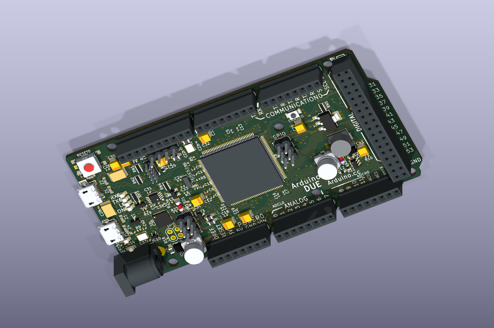

# Arduino Due V03 in KiCad

Open **[Arduino-DUE-V03.kicad_pro](Arduino-DUE-V03.kicad_pro)** in the
**KiCad 10 Project Manager**, then double-click `Arduino-DUE-V03.kicad_pcb`
in the project tree. You can also open the
[PCB](Arduino-DUE-V03.kicad_pcb) directly in the PCB Editor.
This is the working Due reference for the
owner's board. The alternate [V02g board](../v02g/DUE_V02g.kicad_pcb)
is retained for comparison.

The owner reported DUE R3 silkscreen, an AMS1117 regulator, a separate
inductor and a six-pin IC2 on 2026-11-01. That matches V03's power-supply
topology rather than V02g's IC5 module. The source specifies NCP1117 at
IC4; AMS1117 is a reported substitution, and IC2's exact marking is
unreported. [Observation record](../hardware-observations.json).

The source is `Arduino-DUE-V03`, retained as the original extracted EAGLE
[PCB](source/Arduino-DUE-V03.brd) and [schematic](source/Arduino-DUE-V03.sch).
Download ZIPs are intentionally omitted; their original names and hashes
remain in `sources.json`. Original publisher notices remain in these
source files. This is a local conversion, not an Arduino-published native
KiCad design.

| File | Purpose |
|---|---|
| `Arduino-DUE-V03.kicad_pro` | Project entry point and shared settings; initialized from KiCad 10.0.6's default template |
| `Arduino-DUE-V03.kicad_pcb` | Full converted PCB with embedded 2D footprints |
| `Arduino-DUE-V03.kicad_dru` | Importer-generated rules, not a fully verified project setup |
| `source/Arduino-DUE-V03.brd` | Unmodified EAGLE PCB |
| `source/Arduino-DUE-V03.sch` | Unmodified EAGLE schematic; no native KiCad schematic conversion |
| `sources.json` | Archive provenance, file hashes and layer-recovery notes |
| `import-report.json` | KiCad import statistics and diagnostics |
| `validation.json` | Source correspondence, reload and SVG-export checks |
| `import-board.py` / `check-board.py` | Recreate the board / verify it |

The PCB was originally imported in standalone mode, which did not create
a project file. The added `.kicad_pro` uses the same basename as the PCB
so KiCad opens them together. It starts with KiCad defaults; fabrication
rules and source net-class constraints have not been qualified. The
importer-generated `.kicad_dru` remains alongside it. Reimporting the board
preserves the project file and its settings.

The `.kicad_prl` file is local editor/view state and is ignored by Git.
There is still no native `.kicad_sch`; the original EAGLE schematic is
retained under `source/`. Creating a project file does not convert it.

KiCad **10.0.6** imports all **129 source components**, plus six footprints
for standalone mounting holes. All **591 source pad-to-net assignments**
match, and all component positions match within 0.000002 mm. Sixteen
references without numeric suffixes gain a trailing `0`; `validation.json`
records the mapping. Native load/save/reload and top-layer SVG export pass.
The import report contains no warnings or errors.

The importer puts seven unique straight-line restriction geometries on
an invalid `UNDEFINED` layer, merging front/back duplicates. The script
recovers all ten source lines as reference drawings: five front lines on
`User.1`, five back lines on `User.2`. **These lines do not enforce copper
keepouts.** Imported circular rule areas are separate. This board is for
reference and inspection; it has not been qualified for fabrication.
The owner's power-layout observations support using it as the reference;
full-board geometry and electrical continuity remain to be checked physically.

## The analog reference network (AREF, ADVREF)

Read from `Arduino-DUE-V03.kicad_pcb` (the same nets are in the EAGLE schematic).
`tests/test_due_reference_network.py` holds this table to the PCB. It is the
converted board file, not the owner's physical board: check continuity before
reworking anything.

| Net | Pads on it |
|---|---|
| `AREF` | BR1 pad 1, and the AREF header pin (header `PWMH0` pad 8). Nothing else |
| `AVREFL` | BR1 pad 2, JR1 pad 2, C34 (100 nF to ground), L3 pad 1 |
| `AVREF` | L3 pad 2, C19 (100 nF to ground), the SAM3X's ADVREF pin (U1 pad 75) |
| `+3V3` | BR1 pad 3, JR1 pad 1, and the rest of the 3.3 V rail |

L3 is the ferrite bead `MH2029-300Y` in an 0805, which by its part number is 30
ohms at 100 MHz *(check)*. BR1 is the 0402 three-pad jumper `J0402`, not mounted,
on the top copper layer, with 1.3 mm between pad centres. JR1 is a 0 ohm 0402 on
the top layer.

**As shipped,** JR1 joins 3.3 V to `AVREFL`, and the converters' reference is
3.3 V through L3 and C19. The AREF header pin goes nowhere.

**To drive ADVREF from outside,** which the AFE requirement calls D6, in this order:

1. Remove JR1.
2. Bridge BR1 pads 1 and 2: a 0402 0 ohm part fits the footprint, and a solder
   bridge across the gap of 0.6 mm (pads 0.7 mm long on a 1.3 mm pitch) also reaches, with less margin. The AREF header pin is then
   `AVREFL`, and ADVREF follows it through L3.
3. Check continuity before power: AREF to ADVREF closed, 3.3 V to AREF open.

**The order matters.** With BR1 pads 1 and 2 bridged and JR1 still fitted, the
AREF pin is tied to the 3.3 V rail through 0 ohms, and whatever drives AREF is
shorted to it.

Both parts are on the top layer under where a shield sits, so the rework is done
before stacking. A shield reaches AREF through the stacking header, with no jumper
wire. On the Due it is header `PWMH0` pad 8 in this board file, the AREF pin of
the header.

**The load an external reference sees:** C34, then the bead, then C19, about 200 nF,
before any trace and header contact on the shield. It has to be stable with that
and with the converters' switching load, a datasheet check. A Due reworked this way
and run without a reference connected has a floating ADVREF.

**Without touching JR1,** or with a way back:

- **Do not drive ADVREF.** Leave the Due stock and let the ADC read the shield's
  reference as an input. That gives each board's absolute gain and its drift to the
  host, and needs no rework; it does not quieten ADVREF.
- **Use BR1 as the selector it was drawn as.** Remove JR1 once, then bridge BR1 pads
  2 and 3 for the stock behaviour (3.3 V to AVREFL, the same connection JR1 made) or
  pads 1 and 2 for an external reference. With 2 and 3 bridged the Due works alone
  and a shield driving AREF cannot hurt it. With 1 and 2 bridged and no reference
  connected, ADVREF has no source, and the converters do not work.
- **Rework one Due only,** and keep it with the shield. The others stay stock, which
  also gives a control.

Removing JR1 and leaving BR1 open does leave ADVREF with no source: the only paths
into `AVREFL` and `AVREF` are JR1 and BR1.

Not established by the board file: the highest ADVREF the SAM3X accepts against its
analog supply `VDDANA` (3.3 V through a second bead, L1), a datasheet check.

## 3D view

**119 component models are assigned.** The owner-supplied STEP assembly provides 18:
the MCU, both USB connectors, barrel jack, main headers, debug/SPI/ICSP/JTAG
headers, two large capacitors and reset switch. Another 91 assignments use
standard KiCad package bodies, and 10 use documented simplified bodies for
the fuses, power inductor, small crystal, ESD protectors and erase switch.
Reopen the PCB from disk
and choose **View -> 3D Viewer** (Option+3 on macOS).



The owner reported on 2026-11-01 that the initial 18-model preview passed a first visual
inspection and matches the physical board well. This is an overall visual
check, with no dimensional measurements or electrical checks reported.
The expanded population shown above has not yet been inspected by the owner.
[Observation record](../hardware-observations.json).

The source board is 101.6 x 53.34 mm and its six mounting-hole centers
match V03's EAGLE source within 0.000006 mm. Bodies retain the source's
small placement offsets, including the MCU's 0.020 mm center offset.
These are CAD correspondence checks, not physical measurements. Connector
heights, detailed pin fit and component substitutions are not qualified.

The supplied assembly's PCB slab is excluded so the native PCB and copper
remain visible. Its oversized LED bodies and generic capacitor bodies are
also excluded; standard package and simplified bodies now fill the small
components. Four bare fiducials and six source NM items (including BR1)
remain without bodies. Generic
plastic/metal colors improve visibility; they do not identify actual
materials or capacitor values. New package models align polarity and pin-1
to the source pad layout; installed markings and body heights remain
unqualified. In particular the tantalum B-case bodies and erase-switch
height are approximations. The
[model preparation/alignment record](../models/README.md) lists all assets
and exclusions. [Attachment evidence](models-3d.json) confirms every
non-model line of the PCB file is unchanged.

`attach-models.py` restores these assignments without rewriting the native
geometry. `import-board.py` also reapplies them when `models/alignment.json`
is present. The checker verifies all assigned file paths and hashes.

From the repository root, recreate the conversion (overwrites this V03
PCB and its import/provenance records):

```sh
python3 hardware/reference/arduino-due/v03/import-board.py
```

Then verify with KiCad's bundled Python on this Mac:

```sh
/Applications/KiCad/KiCad.app/Contents/Frameworks/Python.framework/Versions/3.9/bin/python3 hardware/reference/arduino-due/v03/check-board.py
```

On another system use Python with KiCad 10's `pcbnew` module available.
Set `KICAD_CLI` if the executable is not on PATH or at the default macOS
location. The checker writes `validation.json` and uses temporary files
for its reload and SVG checks.
